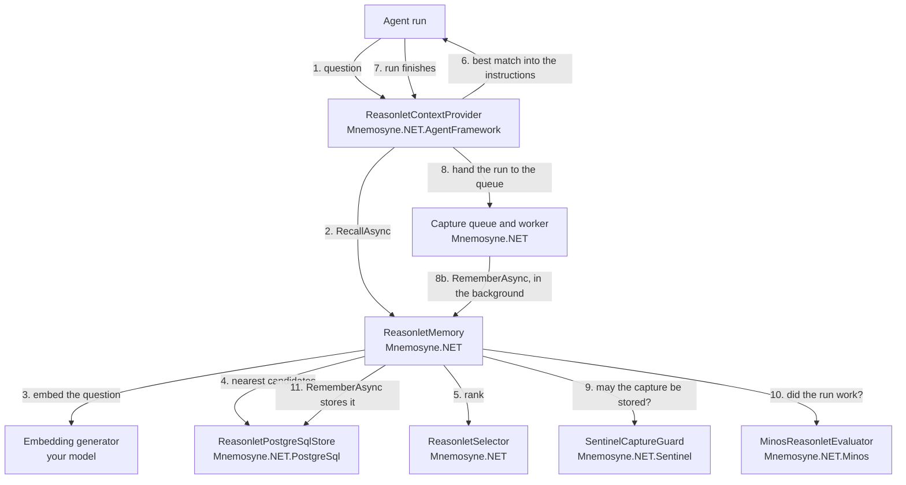

# Overview

Mnemosyne is six NuGet packages. This page says what each one holds, follows one call through them, and points from a goal to the page that covers it.

## The packages

| Package | What it holds | Reference it when |
|---|---|---|
| `Mnemosyne.NET.Abstractions` | The records, such as the capture, query and graph, and the contracts: the `IReasonletMemory` facade and the `IReasonletStore`, `IReasonletSelector`, `IIntentExtractor`, `IReasonletEvaluator` and `ICaptureGuard` ports. | You write a store, a selector, an intent extractor, an evaluator or a capture guard of your own. Every other package brings it in. |
| `Mnemosyne.NET` | The default facade `ReasonletMemory`, the default ranking `ReasonletSelector` and the `AddMnemosyne` registration. It also holds the chat pipeline (`UseReasonlets`), the capture queue and worker (`AddReasonletCapture`) and `ChatReasonletEvaluator`, which judges runs with a chat model. | Always. It is the memory your agent calls. |
| `Mnemosyne.NET.PostgreSql` | The PostgreSQL and pgvector store, its migrations and `AddMnemosynePostgreSql`. | Always, today. It is the only store. |
| `Mnemosyne.NET.Minos` | `MinosReasonletEvaluator`, which judges each run with a Minos.NET decision model. | You want a calibrated yes/no verdict on each run. |
| `Mnemosyne.NET.Sentinel` | `SentinelCaptureGuard`, which runs AI.Sentinel's detectors over a capture before it is stored. | You want a capture blocked when a detector fires. |
| `Mnemosyne.NET.AgentFramework` | `ReasonletContextProvider`, which adds recall and capture to a Microsoft Agent Framework agent. | Your agent runs on Agent Framework. |

A typical host references `Mnemosyne.NET` and `Mnemosyne.NET.PostgreSql`, and adds the others for the one job each does. The six packages share a version number from 1.0.0. [Compatibility](compatibility.md) has the rules.

## One call through the packages

A host registers a store, an embedding generator and the facade. It can add an evaluator, a capture guard and the Agent Framework provider. The diagram follows one run of an agent that has all of them.

The records and interfaces these classes exchange come from `Mnemosyne.NET.Abstractions`. Steps 1 to 6 are a recall: the provider asks the facade, the facade embeds the question, asks the store for the nearest procedures and lets the selector rank them. Steps 7 to 11 are a capture. The provider hands the finished run to the capture queue, and a background worker calls `RememberAsync`. The facade asks the guard whether the capture may be stored, asks the evaluator whether the run worked when the capture carries an answer, and stores the result. A run recorded later with `RecordExecutionAsync` is judged the same way.

The guard, the evaluator and the Agent Framework provider are optional. Without the provider, a chat client uses `UseReasonlets` from `Mnemosyne.NET` instead, and a plain program calls `IReasonletMemory` itself, as [Getting started](../getting-started.md) does.

## Start here

| If you want to | Read the concept | Then the guide |
|---|---|---|
| Try it in a console app | [Reasonlets](reasonlets.md) | [Getting started](../getting-started.md) |
| Recall in a chat app | [Ranking](ranking.md) | [The chat pipeline](../guides/chat-pipeline.md) |
| Use it from an agent | [Reasonlets](reasonlets.md) | [Agent Framework](../guides/agent-framework.md) |
| Judge runs | [Evaluation](evaluation.md) | [Judging runs with Minos](../guides/minos-evaluator.md) or [with a chat model](../guides/chat-evaluator.md) |
| Scope per tenant | [Scopes and subjects](scopes-and-subjects.md) | [Agent Framework](../guides/agent-framework.md#scope-and-subject) or [the chat pipeline](../guides/chat-pipeline.md#scope) |
| Erase a person | [Scopes and subjects](scopes-and-subjects.md#erasure) | [Data lifecycle](../guides/data-lifecycle.md#erasure) |
| Meet data-protection duties | [Scopes and subjects](scopes-and-subjects.md#subjects) | [Data protection](../guides/data-protection.md) |
| Block or review captures | [Reasonlets](reasonlets.md#status-active-and-pendingreview) | [Capture, redaction and review](../guides/capture-and-review.md) |
| Keep versions of a procedure | [Versions and lineage](versions.md) and [Variants](variants.md) | [Capture, redaction and review](../guides/capture-and-review.md#the-three-outcomes) |
| Plan an upgrade | [Compatibility](compatibility.md) | [PostgreSQL store](../guides/postgresql.md#upgrading) |
| Build a host | [Scopes and subjects](scopes-and-subjects.md) | [Daedalus and Thalos](../guides/daedalus-and-thalos.md) |
