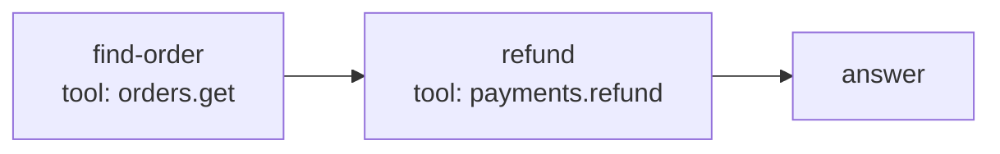

# Reasonlets

A Reasonlet is one stored procedure: the question it answered, the steps that answered it, and the record of how well it works.

```text
Question → Procedure → Answer
```

## What a Reasonlet holds

| Part | What it is |
|---|---|
| **Question** | The question the procedure answered, in the user's words. Mnemosyne embeds it, so recall can find the Reasonlet for a question worded differently. |
| **Graph** | The procedure: a graph of steps that typically ends in an answer. |
| **Intent** | A short label for the kind of problem, such as `refund`. Recall can filter on it. |
| **Name** | A readable name for people and logs. |
| **Version** | `1.0` for a new procedure, `1.1`, `1.2` and so on for improved versions of it. See [Versions and lineage](versions.md). |
| **Scope** | The partition it lives in, usually a tenant. See [Scopes and subjects](scopes-and-subjects.md). |
| **Provenance** | Where it came from. |
| **Status** | `Active` or `PendingReview`. |
| **Runs** | How often it ran and how often that succeeded, and when it last ran. |

You don't build a Reasonlet directly. You hand `RememberAsync` a `ReasonletCapture`, which holds the scope, question, graph, the outcome of the run and the provenance, and optionally a name, an intent and a parent. Mnemosyne fills in the rest and returns a receipt with the Reasonlet's id, its version and what the capture produced.

## The graph

The graph is a list of nodes and a list of directed edges between them.



- **A node** has an `Id` and a `Type`. The well-known types are `tool`, `retrieve`, `decision`, `agent` and `answer`, and other values are allowed. A node can also carry a display `Name` and the `Tool` it calls.
- **An edge** goes `From` one node `To` another. An optional `Condition` says when to follow it, so a decision node can branch.
- **Properties.** The graph, its nodes and its edges can each carry free-form JSON properties, for whatever your runtime needs to replay a step, such as tool arguments.
- **`SchemaVersion`** is currently 1. Set it to `ReasonletGraph.CurrentSchemaVersion`.

Mnemosyne checks the graph when you remember it: node ids must be unique, every edge must point at existing nodes, and there are limits on size. A graph holds at most 500 nodes and 2,000 edges.

Mnemosyne stores the graph and never runs it. Your agent decides how to carry out each step.

Two graphs are the same procedure when they have the same content, whatever the order of their nodes, edges and properties. This decides what happens when you remember a graph with a parent, as [Versions and lineage](versions.md) explains.

The graph's JSON form has a [published JSON Schema](https://github.com/MarcelRoozekrans/Mnemosyne.NET/blob/main/schemas/reasonlet-graph.v1.schema.json). The schema can't express every rule, so `ReasonletGraph.Validate()` remains the full check.

## Intent

The intent is a short label for what the question is about. Recall uses it as a filter, so a refund question doesn't compete with a password-reset procedure that happens to use similar words.

You can supply the intent yourself, on the capture and on the query. You can also register an `IIntentExtractor`, which reads a question and returns an intent with a confidence between 0 and 1. Mnemosyne treats the two moments differently.

**When remembering**, the stored intent is:

1. the capture's own `Intent`, when it has one;
2. else the extractor's answer, at any confidence, because a stored intent is better than none;
3. else `unspecified`.

If the extractor is needed and is down, the remember fails with `Unavailable` rather than storing a guess.

**When recalling**, the filter is:

1. the query's own `Intent`, when it has one;
2. else the extractor's answer, but only when its confidence is at least 0.7;
3. else no filter: recall searches every intent.

A wrong filter would hide every right answer, so recall filters only on an intent it is confident about. If the extractor is needed and is down, recall searches without a filter and still succeeds. The 0.7 threshold is `MnemosyneOptions.MinIntentConfidence`.

## Name

When the capture has no `Name`, Mnemosyne takes the first line of the question that isn't blank, trims it, cuts it to 200 Unicode code points, and trims the end again. A cut never splits a character that takes two UTF-16 units, such as an emoji.

The stored Reasonlet carries the resolved intent and name, so what recall returns is what remember decided.

## Provenance

`ReasonletProvenance` records where a Reasonlet or a run came from:

- **`Source`**, required: what produced it, such as the name of your agent.
- **`RunId`**, optional: the id of the run in your own system, so you can trace a Reasonlet back to it.
- **`SubjectId`**, optional: the person the record is about. It is what makes [erasure by subject](scopes-and-subjects.md#subjects) possible.
- **`Tags`**, optional: free-form key-value pairs.

Each run you record carries its own provenance too.

## Runs and outcomes

Every capture records one run, with the capture's `ReasonletOutcome`: whether it succeeded, how long it took, and an optional quality score between 0 and 1. After that, `RecordExecutionAsync` records each further run.

Mnemosyne keeps a running count of runs and successes for each Reasonlet, and the times of its latest run and latest success. Ranking reads these. You can also attach feedback to a recorded run with `RecordFeedbackAsync`. Feedback is stored, but ranking doesn't use it.

## Status: Active and PendingReview

A Reasonlet is either `Active` or `PendingReview`.

- **`Active`** Reasonlets take part in recall.
- **`PendingReview`** Reasonlets are stored but never returned by recall. The status is there for a review step, where a person approves a captured procedure before agents may use it.

Nothing sets `PendingReview` today: every capture is stored as `Active`, and the receipt reports the status.

## What recall returns

Recall returns a list of matches, best first. Each match holds the stored Reasonlet, with its graph, intent, version and provenance, and a `ReasonletScore` with each part of the ranking. [Ranking](ranking.md) explains the score.
