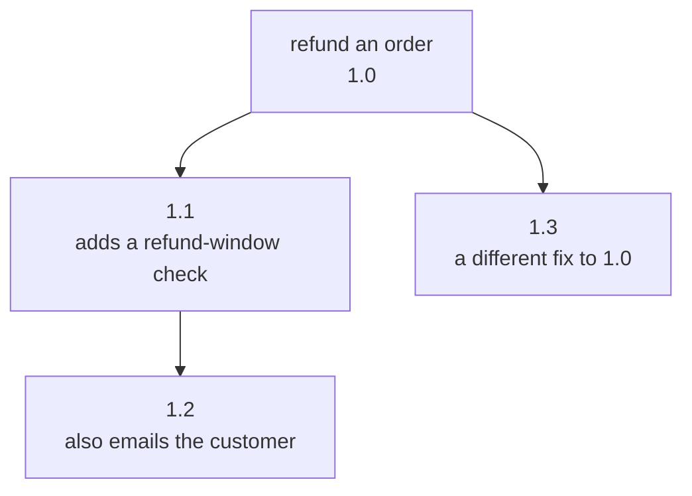
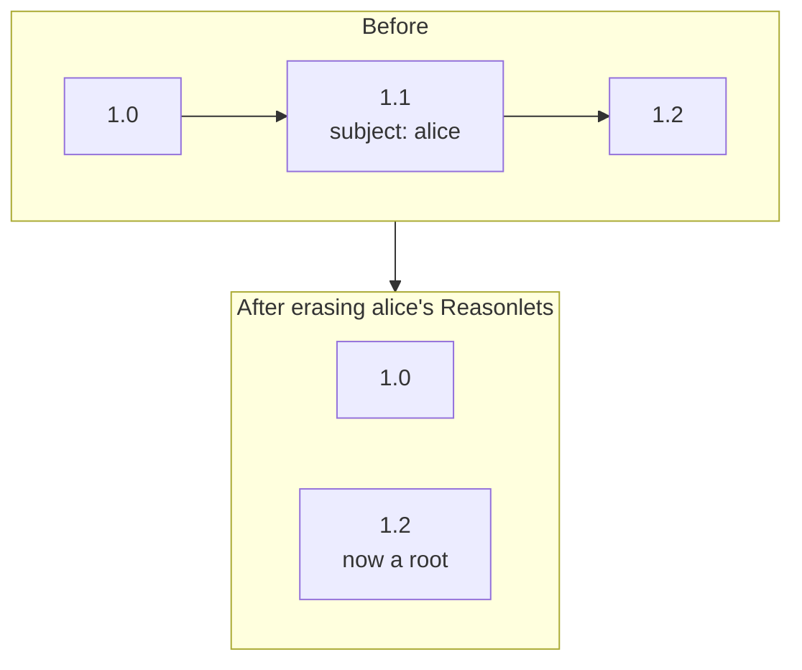

# Versions and lineage

Procedures improve. An agent recalls a procedure, follows it, and finds a better way: an extra check, a step that is no longer needed. Mnemosyne keeps the improved procedure as a **new version** of the one it came from, linked to it, so the new version can build on the old one's track record.

## The parent

A capture says which Reasonlet it came from through `ParentId`. Leave it out for a brand-new procedure. Set it to the id of the recalled Reasonlet when the agent followed, or adapted, that one.

```csharp
var capture = new ReasonletCapture
{
    Scope = scope,
    Question = question,
    Graph = graphTheAgentFollowed,
    Outcome = outcome,
    Provenance = provenance,
    ParentId = match.Reasonlet.Id, // the recalled match the agent started from
};
```

The parent must exist in the same scope. If it doesn't, the remember fails with `NotFound`.

## Three outcomes of a capture

The store decides what a capture produces, in one atomic step. The receipt's `Kind` tells you which it was.

| Capture | Result | `Kind` |
|---|---|---|
| No `ParentId` | A new Reasonlet, at version `1.0`. | `NewReasonlet` |
| `ParentId` set, and the graph is the same as the parent's | No new Reasonlet. The capture's outcome is recorded as a run of the parent. | `ExecutionOnly` |
| `ParentId` set, and the graph differs | A new version, linked to the parent. | `NewVersion` |

"The same graph" means the same content. The order of nodes, edges and properties doesn't matter.

So an agent can always remember with the recalled id as the parent. If it followed the procedure unchanged, Mnemosyne records a run. If it changed the procedure, Mnemosyne stores the change as a version.

Every outcome records a run, so the receipt also carries the id of that run.

## Version numbers

A lineage is a root Reasonlet and every version below it. Versions are numbered `1.<k>`, counting across the whole lineage: the root is `1.0`, and each new version gets one more than the highest number in its lineage, wherever in the tree its parent sits.



Here `1.3` is a second version of `1.0`, made after `1.2` existed. Two versions of the same parent are siblings, which happens when two agents improve the same procedure in different ways, or when two captures arrive at the same time.

## How a version ranks

A new version starts with one run, so on its own record it would look unproven next to its parent. Mnemosyne handles this by letting a version inherit its parent's record, upward only:

- **A version of a proven procedure** starts from its parent's success rate, and its own runs take over as they accumulate.
- **A version of a failing procedure**, which is usually a fix, starts at a neutral 0.5 like any new procedure. Its parent's failures don't hold it back.

Inheritance goes one level, to the parent only, because the parent is the version this one replaced. [Ranking](ranking.md#a-new-version-inherits-upward-only) has the formula and a worked example.

## What erasure does to a lineage

Erasing a scope removes every Reasonlet in it, so whole lineages go. Erasing by subject is more selective: it removes that person's Reasonlets, with all their runs and feedback, and keeps everyone else's. A kept child of an erased Reasonlet is not erased with it. Instead, its link to its parent is cut, and it becomes the root of a lineage of its own.



- The child keeps its version label, here `1.2`.
- With no parent, it no longer inherits: it ranks with the neutral 0.5 prior, on its own runs.
- A later version of it is numbered within its own, new lineage.

Pruning is different. A prune removes Reasonlets that nobody has used for a while, but it judges use across a lineage, and keeps a Reasonlet while any version below it is still in use. **Pruning never cuts a parent link.** No kept version loses its parent to a prune.
