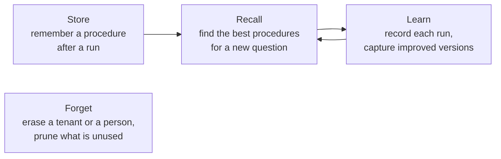

# Mnemosyne.NET

Procedural memory for .NET agents: store, find and reuse the problem-solving procedures that worked.

## Why procedural memory

An agent that answers "help me troubleshoot our Azure OpenAI endpoint" does real work. It looks up the docs, checks the endpoint, the deployment and the API version, and then recommends a fix. The answer goes back to the user, and the way the agent got there is lost. The next time a similar question comes in, it plans from scratch.

Mnemosyne keeps that procedure. It stores how a problem was solved, tracks whether that worked, and hands the best known procedure back when a similar question arrives. The agent still decides what to do with it.

Each stored procedure is a **Reasonlet**:

```text
Question → Procedure → Answer
```

The procedure is a small graph of steps, such as tool calls, retrievals and decisions, that typically ends in an answer. Mnemosyne stores it with an embedding of the question, so a differently worded question can still find it, and with a record of every run, so it knows which procedures work.

Other kinds of memory answer other questions:

| Memory | Question it answers |
|---|---|
| Knowledge, such as a RAG index | What do we know? |
| Decisions | What decision should be made? |
| **Procedures, with Mnemosyne** | **How did we solve this before, and did it work?** |

## The loop

Mnemosyne works as a loop of three steps, with forgetting alongside it.



1. **Store.** After a run, the agent remembers the question, the procedure it followed and whether it worked.
2. **Recall.** For a new question, Mnemosyne finds the stored procedures that match it and ranks them by similarity, track record and freshness. Every match carries its score breakdown, so you can see why it ranked where it did.
3. **Learn.** The agent records each run of a recalled procedure. When it improves a procedure, it remembers the improved one as a new version. The new version starts from its parent's track record when that record is better than neutral, so an improvement on a proven procedure isn't ranked as unproven.

**Forget** is not a step in the loop: you erase or prune when you need to. You can erase everything for a tenant, or everything that belongs to one person, through `IReasonletMemory`. Pruning procedures nobody uses any more is `PruneAsync` on the store, not on `IReasonletMemory`, because it is an administrative job the host schedules. [Data lifecycle](guides/data-lifecycle.md) covers both.

## When to use it

Mnemosyne fits when:

- your agent solves recurring kinds of problems through several steps, such as tool calls, and planning each one from scratch is slow or costly;
- you want the agent to prefer the procedures that worked, and to see why one was chosen over another;
- you serve several tenants or users, and their procedures must stay apart and be erasable.

## When not to use it

Mnemosyne is not the right tool when you want:

- **an answer cache.** Mnemosyne returns procedures, not finished answers. The agent runs the procedure again for the new question.
- **a workflow engine or a graph executor.** Mnemosyne never runs a procedure. Your agent, or whatever runtime it uses, decides how to carry out the steps.
- **a store for facts and documents.** That is knowledge retrieval, which a RAG index does better.

It also needs PostgreSQL 15 or later with pgvector 0.8.0 or later. There is no in-memory or other database store.

## Packages

| Package | What it holds |
|---|---|
| `Mnemosyne.NET.Abstractions` | The records, such as the capture, query and graph, and the interfaces: the `IReasonletMemory` facade and the store, selector and intent-extractor ports. |
| `Mnemosyne.NET` | The default facade, `ReasonletMemory`, and the default ranking, `ReasonletSelector`, with the `AddMnemosyne` registration. |
| `Mnemosyne.NET.PostgreSql` | The PostgreSQL and pgvector store, with its migrations and the `AddMnemosynePostgreSql` registration. |

Most applications reference `Mnemosyne.NET` and `Mnemosyne.NET.PostgreSql`, and get the abstractions with them. Embeddings come from any `IEmbeddingGenerator<string, Embedding<float>>` from Microsoft.Extensions.AI, so you pick the model. All three packages target .NET 10 and are compatible with native AOT and trimming.

## Where to go next

- [Getting started](getting-started.md) wires Mnemosyne into a console app, then remembers, recalls and records a run.
- [Reasonlets](concepts/reasonlets.md) explains what is stored.
- [Ranking](concepts/ranking.md) explains how recall orders its matches.
- [Samples](samples.md) has a complete program you can run with only Docker and the .NET SDK.
